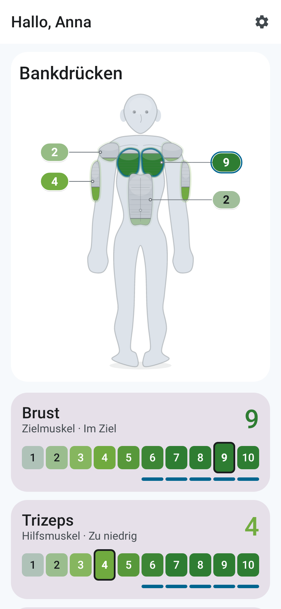
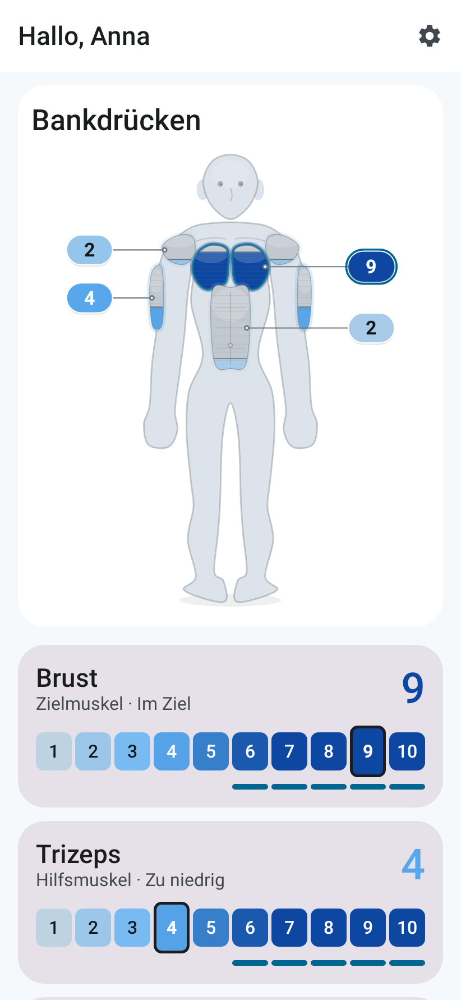
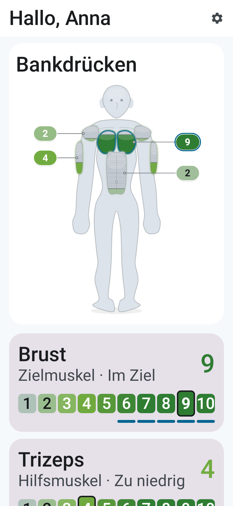
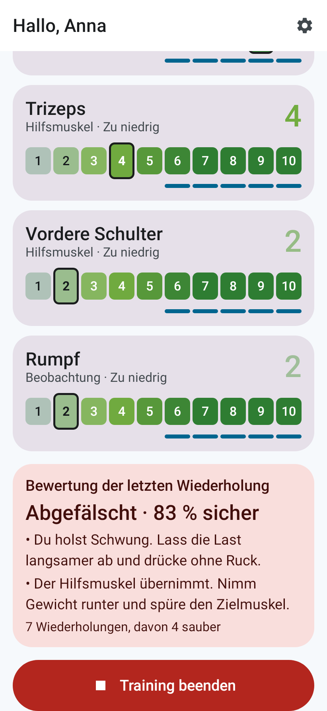
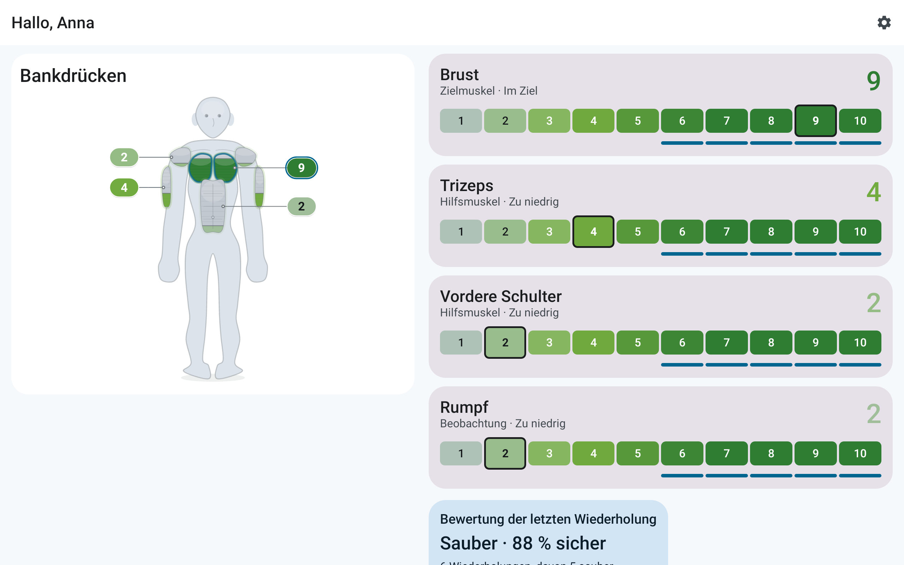
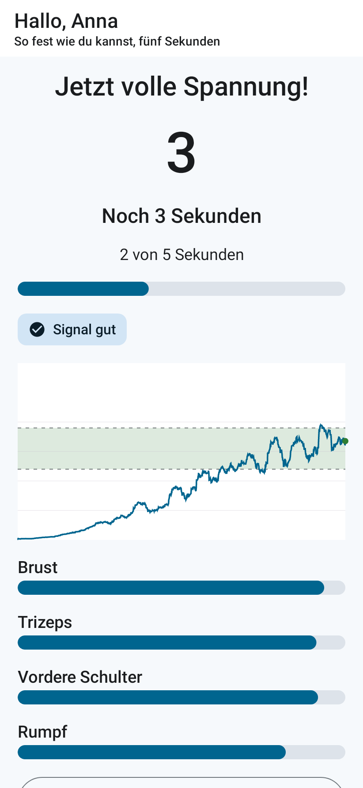

# GIBAGym

Android-App eines kostengünstigen EMG-Biofeedback-Systems zur Verbesserung der
Übungsausführung im Krafttraining. HTL-Diplomarbeit.

Ein Wearable auf Basis eines ESP32-S3 misst über Oberflächenelektroden die
Muskelaktivität und schickt sie per Bluetooth Low Energy an diese App. Die App
normiert die Rohwerte auf die individuelle Maximalkraft (MVC), lässt eine KI die
Ausführung bewerten und gibt dem Trainierenden in Echtzeit verständliches
Feedback — über einen 2D-Körper-Avatar, einen Live-Graphen und Vibration.

**Alle Daten bleiben auf dem Gerät.** Es gibt kein Backend, kein Konto und keinen
Upload-Pfad im Code.

Dieses Repository enthält den **Frontend- und UI-Prototyp**: alle Bildschirme, die
Renderarchitektur und die Schnittstellen, gegen die die drei Fachkomponenten
(Signalverarbeitung, BLE-Sicherheit, KI) entwickelt werden. Diese Komponenten sind
hier bewusst nur als naive Platzhalter vorhanden, jeder mit einem `TODO(Name)`
versehen.

---

## Schnellstart

Voraussetzungen: JDK 17 oder neuer, Android SDK mit API 35.

```bash
# Debug-APK bauen
./gradlew assembleDebug

# alle Unit-Tests
./gradlew test

# Screenshots neu aufnehmen (schreibt nach docs/screenshots/)
./gradlew :app:recordRoborazziDebug

# Screenshots gegen den Stand im Repository prüfen
./gradlew :app:verifyRoborazziDebug
```

Die App läuft **ohne Hardware**. Beim ersten Start führt „Erste Schritte“ durch
Elektrodenplatzierung und Kalibrierung; die Datenquelle lässt sich jederzeit
zwischen Simulation, CSV-Wiedergabe und (noch nicht implementiertem) Wearable
umschalten.

## Was der Prototyp zeigt

| Bildschirm | Anforderung | Zustand |
|---|---|---|
| Erste Schritte | — | vollständig |
| MVC-Kalibrierung | /LF20/ | vollständig, Spitzenwertverfahren ist Platzhalter |
| Live-Training mit Avatar und EMG-Graph | /LF30/, /LF40/ | vollständig |
| Ratio-Analyse Ziel- gegen Hilfsmuskel | /LF50/ | vollständig, Momentanwertverfahren ist Platzhalter |
| KI-Bewertung sauber/abgefälscht | — | Anzeige vollständig, Klassifizierer ist Platzhalter |
| Verlauf und Profil | /LF60/ | vollständig, Speicher ist flüchtig |
| Demo-Modus-Umschalter | — | vollständig |

## Screenshots

Alle Bilder in [`docs/screenshots/`](docs/screenshots/) sind echte Renderings aus
den Compose-Screenshot-Tests (Roborazzi + Robolectric, nativer Skia-Renderer), nicht
nachgestellte Entwürfe. Sie entstehen neu mit `./gradlew :app:recordRoborazziDebug`.

| Live-Training | Rot-grün-sichere Palette | 200 % Schriftgröße |
|---|---|---|
|  |  |  |

| Ratio und KI-Bewertung | Tablet im Querformat | MVC-Kalibrierung |
|---|---|---|
|  |  |  |

Die vollständige Liste steht in [`docs/screenshots/README.md`](docs/screenshots/README.md).

## Gerätetest

Zusätzlich zu den Screenshot-Tests wurde die App in einem Android-Emulator
(Pixel 6, API 34) tatsächlich gestartet und durchgespielt: Onboarding,
MVC-Kalibrierung mit laufendem Messdatenstrom, Live-Training. Die Aufnahmen und
die dabei gefundenen Fehler stehen in
[`docs/geraetetest/`](docs/geraetetest/README.md).

Gemessene Ende-zu-Ende-Latenz auf dem Emulator mit Software-Renderer: **20 ms im
Mittel, 96 ms als Maximum** — innerhalb des Budgets von 100 ms aus /LF40/, und das
auf einer bewusst ungünstigen Umgebung.

---

## Module

```
:app                 Navigation, Verdrahtung der Abhängigkeiten, Screenshot-Tests
:core:model          Datenmodell und alle Schnittstellen (reines Kotlin, kein Android)
:core:engine         Signalverarbeitung, Simulator, CSV-Wiedergabe, Renderpuffer
:core:ai             Schnittstelle und Platzhalter der KI-Bewertung
:core:ble            Schnittstellen und Platzhalter der Wearable-Anbindung
:core:ui             Design-System, Avatar, Live-Graph, Haptik, Farbskalen
:feature:onboarding  Erste Schritte
:feature:calibration MVC-Kalibrierung        (/LF20/)
:feature:training    Live-Training und Ratio (/LF30/, /LF40/, /LF50/)
:feature:history     Verlauf und Profil      (/LF60/)
:feature:settings    Demo-Modus, Barrierefreiheit, Glättung
```

`:core:model`, `:core:engine` und `:core:ai` sind reine Kotlin-Module ohne
Android-Abhängigkeit. Das ist kein Selbstzweck: Ihre Tests laufen dadurch in
Millisekunden statt Sekunden, und niemand kann versehentlich einen `Context` in
die Signalverarbeitung ziehen.

## Die zentrale Schnittstelle

Die gesamte Oberfläche arbeitet gegen genau einen Typ:

```kotlin
interface EmgSource {
    val kind: EmgSourceKind
    val channelCount: Int
    val samplingRateHz: Int
    val connection: StateFlow<ConnectionState>
    val frames: Flow<EmgFrame>
}

class EmgFrame(
    val timestampNanos: Long,      // Zeitbasis System.nanoTime, unverändert durch die Pipeline
    val channels: FloatArray,      // Millivolt je Kanal
    val mvcPercent: FloatArray,    // Prozent der individuellen Maximalkraft
    val signalQuality: SignalQuality,
)
```

Drei Implementierungen:

| Klasse | Modul | Zustand |
|---|---|---|
| `SimulatedEmgSource` | `:core:engine` | lauffähig, synthetisches EMG bei 1 kHz |
| `ReplayEmgSource` | `:core:engine` | lauffähig, spielt `app/src/main/assets/aufzeichnungen/bankdruecken-demo.csv` ab |
| `StubBleEmgSource` | `:core:ble` | Platzhalter, meldet ehrlich „nicht implementiert“ |

Weil die UI nur diesen Typ kennt, ändert der Austausch des Platzhalters gegen die
echte BLE-Anbindung keine einzige Zeile Oberflächencode.

## Renderarchitektur: warum 1 kHz nicht in den Compose-State gehört

Der Kern der Diplomarbeit ist die Frage, wie 1000 Messwerte pro Sekunde flüssig
angezeigt werden. Drei Entscheidungen bestimmen das Ergebnis:

**1. Messwerte sind kein Compose-State.** Jeder Wert in einem `mutableStateOf`
würde eine Recomposition auslösen — bei 60 Bildern pro Sekunde wären über 900
davon pro Sekunde wertlos. Stattdessen schreibt die sammelnde Coroutine in einen
gewöhnlichen Ringpuffer (`EmgRenderBuffer`), den die **Zeichenphase** liest.

**2. Die Renderschleife hängt am Display, nicht am Datenstrom.** `FrameTicker`
schreibt in `withFrameNanos` einen einzigen Zustandswert fort. Dieser Wert wird
ausschließlich innerhalb von `drawBehind`/`Canvas`-Lambdas gelesen. Compose merkt
sich die Phase, in der ein Zustand gelesen wurde: Ein nur in der Zeichenphase
gelesener Zustand invalidiert beim Schreiben auch nur die Zeichenphase — keine
Recomposition, kein Layout.

**3. Zahlen werden gedrosselt.** Die Zahlenwerte neben den Balken kommen aus dem
ViewModel-Zustand, der zehnmal pro Sekunde fortgeschrieben wird. Schneller wäre
nicht lesbar und würde bei jedem Bild eine Textmessung auslösen.

Ergebnis: rund zehn Recompositions pro Sekunde statt tausend, bei voller
Bildrate der Messwertanzeige.

### Latenz wird gemessen, nicht behauptet

Jeder `EmgFrame` trägt seinen Entstehungszeitpunkt durch die gesamte Kette. Der
`LatencyTracker` wird **in der Zeichenphase** des Live-Graphen gefüttert und misst
damit die vollständige Strecke: Erzeugung bzw. Übertragung, Filterung,
Gleichrichtung, Glättung, Normierung, Wartezeit auf das nächste Displaybild und
Zeichenaufruf. Der Wert steht sichtbar in der Trainingsansicht, zusammen mit
Mittelwert und Maximum, und wird gegen das Budget von 100 ms aus /LF40/ gefärbt.

### Glättung als Messinstrument

Die Glättung ist zur Laufzeit umschaltbar (`SmoothingStrategy`: kein Verfahren,
gleitender RMS, exponentiell, Median) mit einstellbarer Fensterlänge. Die
rechnerische Verzögerung steht über `SmoothingConfig.expectedDelayMillis()` direkt
daneben. Damit lässt sich der Trade-off Glättung gegen Latenz an derselben
Aufzeichnung reproduzierbar vermessen — dafür existiert der Wiedergabemodus.

## Barrierefreiheit

Die Zielgruppe schließt ältere und ungeübte Menschen ein, und rund 8 % der Männer
unterscheiden Rot und Grün schlecht. Daraus folgen Festlegungen, die im Code
nachvollziehbar sind:

- **Farbe ist nie der einzige Informationsträger.** Jede Aktivierungsanzeige trägt
  zusätzlich eine Füllhöhe und einen Zahlenwert.
- **Drei Farbskalen** zur Auswahl: Standard (Grün/Gelb/Rot), rot-grün-sicher
  (Blau/Orange, zusätzlich in der Helligkeit getrennt) und monochrom. Die Trennung
  in der Helligkeit ist in `ActivationPaletteTest` als Test festgeschrieben.
- **Haptik als zweiter Kanal.** Beim Bankdrücken kann niemand aufs Display schauen.
  `SystemHapticCoach` gibt beim Verlassen des Zielkorridors unterscheidbare
  Vibrationsmuster aus — ein langer weicher Impuls für „zu wenig“, zwei kurze
  harte für „zu viel“.
- **Touch-Targets ab 48 dp**, Hauptschaltflächen 56 bis 64 dp.
- **Schriftskalierung bis 200 %** schneidet nichts ab: Alle Bildschirme scrollen,
  Statusbausteine brechen um. Nachweis: Screenshot 12.
- **Responsiv** über `WindowSizeClass`: Hoch- und Querformat, Telefon und Tablet,
  Navigationsleiste unten oder als Rail an der Seite.

---

## Wer implementiert was

Die Schnittstellen stehen. Jede Fachkomponente wird ersetzt, ohne dass die
Oberfläche angefasst werden muss.

### Berkay Genc — Core Engine

Normierung, Filterung, Ratio-Analyse, lokale verschlüsselte Datenbank.

| Zu implementieren | Schnittstelle | Platzhalter, der ersetzt wird |
|---|---|---|
| Bandpass 20–450 Hz und 50-Hz-Notch | `core/model/.../Signal.kt` → `SignalFilter` | `core/engine/.../Filters.kt` → `DcBlockingSignalFilter` |
| MVC-Normierung mit Baseline und Drift | `core/model/.../Mvc.kt` → `MvcNormalizer` | `core/engine/.../Normalization.kt` → `LinearMvcNormalizer` |
| MVC-Aufnahme über RMS-Fenster statt Spitzenwert | `core/model/.../Mvc.kt` → `MvcCalibrator` | `core/engine/.../Normalization.kt` → `PeakMvcCalibrator` |
| Ratio über Flächenintegration | `core/model/.../Ratio.kt` → `RatioAnalyzer` | `core/engine/.../RatioAnalysis.kt` → `MeanRatioAnalyzer` |
| Robuste Wiederholungserkennung | `core/model/.../Repetition.kt` → `RepetitionSegmenter` | `core/engine/.../Segmentation.kt` → `ThresholdRepetitionSegmenter` |
| Room + SQLCipher, Schlüssel im Keystore | `core/model/.../TrainingHistory.kt` → `TrainingSessionRepository` | `core/engine/.../store/InMemoryTrainingSessionRepository.kt` |
| Persistente Kalibrierung | `core/model/.../Mvc.kt` → `MvcReferenceRepository` | `core/engine/.../store/InMemoryMvcReferenceRepository.kt` |
| Einstellungen über DataStore | `core/model/.../AppSettings.kt` → `SettingsRepository` | `core/engine/.../store/InMemorySettingsRepository.kt` |

Die Verarbeitungskette selbst (`EmgProcessingPipeline`) steht bereits und gibt die
Reihenfolge vor: filtern, gleichrichten, glätten, normieren — bei unverändertem
Zeitstempel.

### Elyesa Imamoglu — BLE-Kommunikation und Sicherheit

| Zu implementieren | Schnittstelle | Platzhalter, der ersetzt wird |
|---|---|---|
| GATT-Verbindung, Notifications, MTU, Verbindungsintervall | `core/model/.../EmgSource.kt` → `EmgSource` | `core/ble/.../StubBleEmgSource.kt` → `StubBleEmgSource` |
| Gerätesuche nach Service-UUID | `core/ble/.../BleContracts.kt` → `BleScanner` | `StubBleScanner` |
| AES-128 (CCM oder GCM), Schlüssel aus LE Secure Connections | `core/ble/.../BleContracts.kt` → `SecureChannel` | `PassThroughSecureChannel` |
| Replay-Schutz mit Schiebefenster | `core/ble/.../BleContracts.kt` → `ReplayGuard` | `MonotonicReplayGuard` |
| GATT-Profil mit der Firmware abgleichen | `core/ble/.../BleContracts.kt` → `GibaGymGatt` | UUIDs sind vorläufig |

Wichtig für die Latenzmessung: Ein BLE-Paket enthält mehrere Abtastwerte. Der
Empfangszeitpunkt gilt für den **letzten** davon, die übrigen liegen entsprechend
früher. Wer allen Abtastwerten denselben Zeitstempel gibt, macht die Latenzanzeige
wertlos. Der entsprechende Hinweis steht im Platzhalter.

### Samoel Bogdanov — KI-Klassifizierung

| Zu implementieren | Schnittstelle | Platzhalter, der ersetzt wird |
|---|---|---|
| Bewertung sauber gegen abgefälscht | `core/ai/.../RepetitionClassifier.kt` → `RepetitionClassifier` | `core/ai/.../HeuristicRepetitionClassifier.kt` |

Die Eingabe ist ein bereits verdichtetes `RepetitionWindow` mit Spitzen- und
Mittelwerten je Kanal sowie der auf 100 Stützstellen normierten Zielkurve. Die
Ausgabe ist ein `RepetitionAssessment` mit Urteil, Modellvertrauen, konkreten
Fehlerbildern (`FormCue`) und der gemessenen Inferenzzeit. Die Oberfläche zeigt
ein unsicheres Modell auch als unsicher an — dafür ist `confidence` da.

Das Modell läuft lokal. Ein Cloud-Aufruf ist keine Option, sondern ein Bruch einer
Zusage des Projekts.

### Maximilian Mizrak — Frontend und UI/UX

Alles unter `:core:ui`, `:feature:*`, `:app` sowie die Renderarchitektur
(`FrameTicker`, `EmgRenderBuffer`, `LatencyTracker`) und die Simulations- und
Wiedergabequellen.

---

## Tests

```bash
./gradlew test                      # 95 Unit- und Screenshot-Tests
./gradlew :core:engine:test         # Glättung, Normierung, Simulator, Wiedergabe
./gradlew :app:recordRoborazziDebug # Screenshots neu aufnehmen
```

| Testklasse | Modul | Prüft |
|---|---|---|
| `SmootherTest` | `:core:engine` | RMS, EMA, Median, Fabrik, Verzögerung je Fensterlänge |
| `NormalizationTest` | `:core:engine` | %MVC-Berechnung, Gleichrichtung, Deckelung, Kalibrierung |
| `SimulatedEmgSourceTest` | `:core:engine` | Ruhe gegen Kontraktion, Amplitudenbereich, Abtastrate, Determinismus |
| `ReplayEmgSourceTest` | `:core:engine` | CSV-Format, defekte Zeilen, Zeitabstände der Wiedergabe |
| `EmgProcessingPipelineTest` | `:core:engine` | Zeitstempeltreue, Glättungswirkung, Gesamtkette |
| `RatioAndSegmentationTest` | `:core:engine` | Ratio-Urteile, Wiederholungserkennung |
| `RenderBufferTest` | `:core:engine` | Ringpuffer-Umlauf, Latenzstatistik |
| `HeuristicRepetitionClassifierTest` | `:core:ai` | Fehlerbilder, Vertrauensbereich |
| `ActivationPaletteTest` | `:core:ui` | Helligkeitstrennung der rot-grün-sicheren Palette |
| `ScreenshotTest` | `:app` | 15 gerenderte Bildschirme |

Flow-Tests nutzen Turbine und die virtuelle Zeit von `kotlinx-coroutines-test`:
Der Simulator hält die Abtastrate gegen eine simulierte Uhr ein, ohne dass ein
Test eine Sekunde lang wartet.

## Demo-Aufzeichnung

`app/src/main/assets/aufzeichnungen/bankdruecken-demo.csv` enthält 31,5 Sekunden
Bankdrücken bei 1 kHz: acht Wiederholungen, davon zwei bewusst mit Schwung
ausgeführt, dazu eine kurze Phase mit verschlechterter Signalgüte. Erzeugt und
reproduzierbar mit `python3 tools/aufzeichnung_erzeugen.py`.

Format: Semikolon als Trennzeichen (damit Excel mit deutscher Ländereinstellung
die Datei direkt öffnet), Punkt als Dezimaltrennzeichen, Zeitstempel relativ in
Millisekunden.

## Technik

Kotlin 2.0.21, Jetpack Compose mit Material 3, Coroutines und Flow, Gradle 8.11
mit Version Catalog, AGP 8.7.3, compileSdk 35, minSdk 26. Tests mit JUnit 4,
Turbine, Robolectric und Roborazzi.

## Was Max noch entscheiden muss

- **Dunkles Design:** Das Farbschema steht, die Screenshots zeigen nur die helle
  Variante. Ob die Aktivierungsfarben im Dunkelmodus eigene Werte brauchen, ist
  offen — die Kontraste gegen dunkle Flächen sind andere.
- **Avatar-Detailgrad:** Aktuell geometrische Grundformen. Anatomisch genauere
  Umrisse wären hübscher, kosten aber Lesbarkeit auf kleinen Flächen.
- **Vorgabewerte der Zielkorridore:** 60–95 % MVC stammt aus der Literatur, nicht
  aus eigener Messung.
- **Vibrationsmuster:** Die drei Muster sind gesetzt, aber nicht mit Nutzern
  erprobt.
- **Umfang des Mehrkanalbetriebs:** Derzeit vier Kanäle fest verdrahtet; ob das
  Wearable mehr liefert, entscheidet die Hardwareseite.
